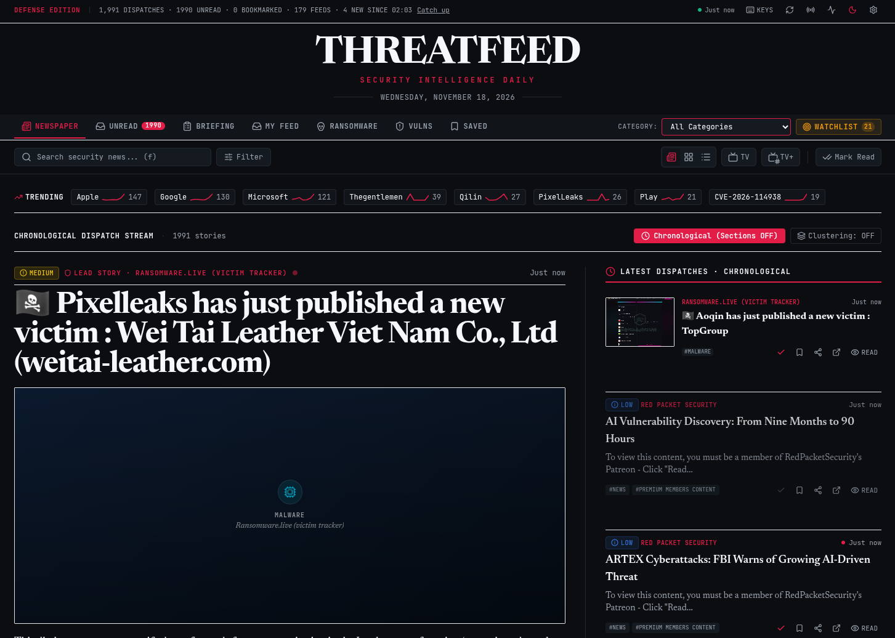

<div align="center">

# 🗞️ ThreatFeed

### Security Intelligence Daily

*A polished, client-side-only security news reader that aggregates curated RSS/Atom feeds into a beautiful digital newspaper.*

[](https://nilaydeotale.github.io/ThreatFeed/)
[](.github/workflows/deploy.yml)
[](LICENSE)
[](https://reactjs.org)
[](https://www.typescriptlang.org)

</div>

---

## 🖼️ A Look at the Front Page

<p align="center">
  
</p>

---

## ✨ What Is This?

**ThreatFeed** is a fully **client-side** security news aggregator. It pulls from **120+ curated security feeds** — The Hacker News, CISA, Cisco Talos, BleepingComputer, Malwarebytes and many more — and lays them out as a digital newspaper with:

- 🗞️ **Editorial newspaper layouts** (broadsheet, list, compact)
- 🛡️ **CVE / KEV / EPSS enrichment** for every story
- 🔍 **Full-text search** (MiniSearch) with combinable filters
- 💾 **Offline-first PWA** powered by IndexedDB
- 📺 **TV & dashboard modes** for wall-mounted screens
- 🖨️ **Printable broadsheet** edition

## 📚 Documentation

| Page | What it covers |
| --- | --- |
| **[📘 Technical Overview](docs/technical.md)** | The full architecture, data sources, feed snapshot pipeline, all 15 feature areas, technology stack and deployment. |
| **[🗒️ CHANGELOG](CHANGELOG.md)** | Version history and release notes. |

## 🚀 Getting Started

```bash
npm install       # install dependencies
npm run dev       # start the dev server (fetches feeds live)
npm run snapshot  # build the static data snapshot (optional)
npm test          # run the test suite
npm run build     # production build → dist/
```

## 🏗️ Architecture (in one line)

**No backend.** The only server-side work is a scheduled GitHub Action that builds a static `snapshot.json` every 30 minutes; the browser loads that snapshot and fetches any missing feeds live through a CORS proxy chain.

See **[docs/technical.md](docs/technical.md)** for the full picture.

---

<div align="center">

*Built with ❤️ by **Nilay Deotale** · MIT Licensed*

*Co‑Authored‑By: Claude Sonnet 3.5 <noreply@anthropic.com>*

</div>
