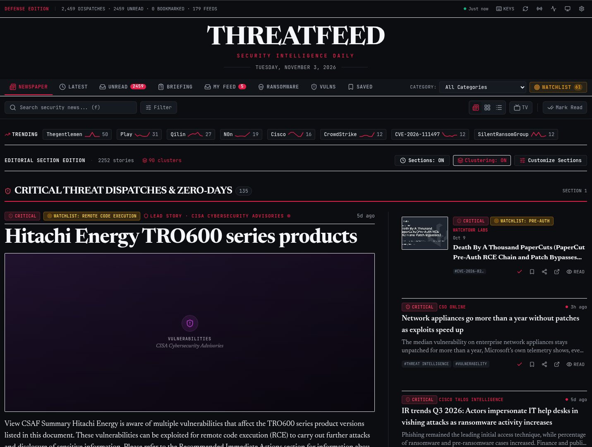

# ThreatFeed — Security Intelligence Daily

> **A polished, modern, client-side-only security news reader that aggregates RSS/Atom feeds and presents them as a beautiful digital newspaper.**

**🌐 Live site: [https://nilaydeotale.github.io/ThreatFeed/](https://nilaydeotale.github.io/ThreatFeed/)**

Inspired by the editorial elegance, typography, and usability of **Newsify for iOS**, ThreatFeed transforms security alerts, threat research, and exploit writeups into a high-end digital publication.



---

## ✨ Highlights

- **Editorial newspaper experience** — front-page hierarchy, true newspaper layouts, multiple layout modes, incremental rendering, freshness indicators.
- **100% client-side** — no backend, no serverless functions; IndexedDB persistence; installable PWA that works offline. The only server-side work is a scheduled GitHub Actions job that builds a static [feed snapshot](docs/FEATURES.md#feed-snapshot--cve-intelligence).
- **Curated security feeds** — 60+ verified feeds across security news, vulnerabilities, threat intel, malware, red team, blue team, cloud, CISO, platform ecosystems and general tech.
- **Intelligence views** — daily briefing, ransomware & breaches, vulns & KEV, Patch Tuesday, entity links and panels, watchlists, keyword monitors and alert rules, trending, My Stack.
- **TV & dashboard modes** — full-screen news walls and figures-first dashboards, with kiosk URLs for dedicated displays.
- **Distraction-free reader** — typography controls, custom tags, Web Share, IOC extraction, CSV / STIX 2.1 export.

The detailed reference for every feature, view and setting lives in [docs/FEATURES.md](docs/FEATURES.md) — feed management, search & filters, keyboard shortcuts, enrichment, sync, and more.

## 🚀 Quick Start

Requires **Node 22+**.

```bash
npm install
npm run dev      # start the dev server
npm test         # run the test suite
npm run lint     # ESLint (flat config), zero warnings
npm run build    # production bundle → dist/
```

## 🛠️ Technology Stack

- **Framework**: React 18 + TypeScript
- **Bundler**: Vite
- **Styling**: Tailwind CSS + Custom CSS Variables + Print Media Queries
- **Typography**: Newsreader (Editorial Serif) + Inter (Sans-Serif UI) + JetBrains Mono (Code/Threat Indicators)
- **Local Persistence**: IndexedDB via `idb`
- **Security & Sanitization**: DOMPurify
- **Icons**: Lucide React
- **Search**: MiniSearch
- **Tests**: Vitest + jsdom

---

## 📄 License

[MIT](LICENSE) © 2026 Nilay Deotale
